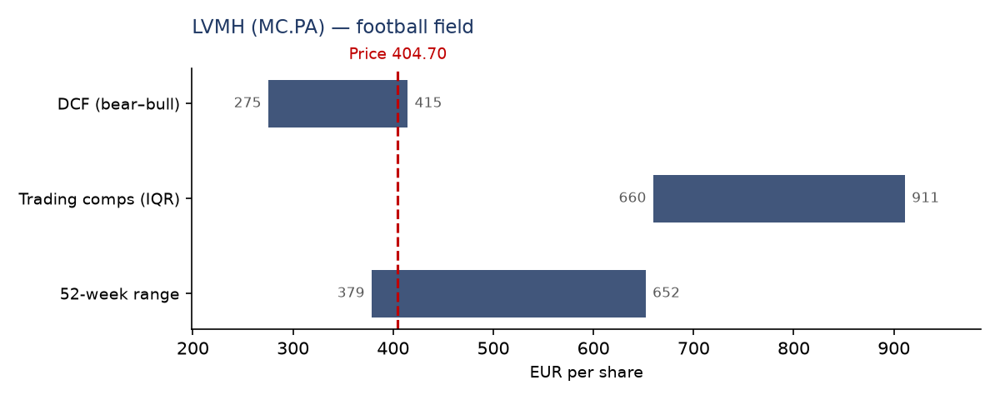
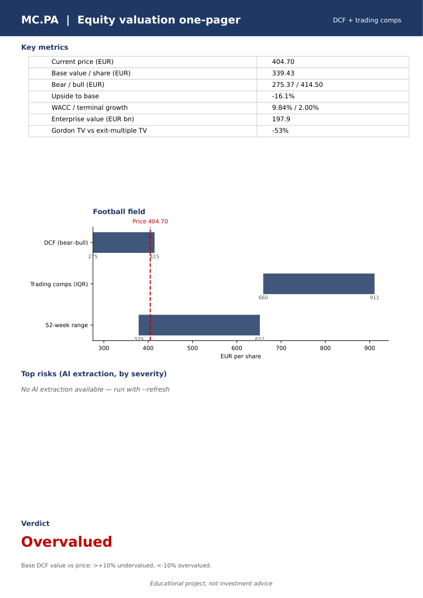
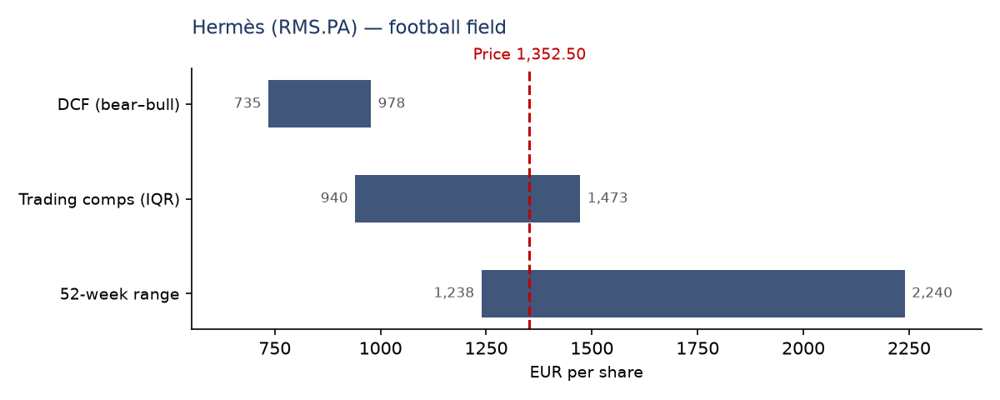
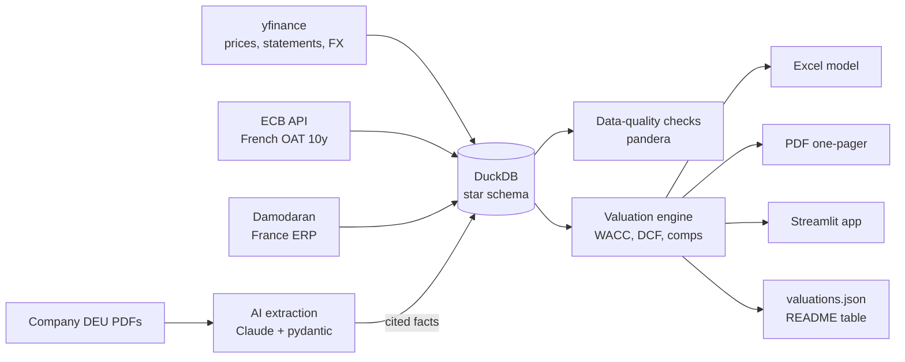

# CAC 40 Luxury Valuation AI

[](https://github.com/GITHUB_USER/cac40-valuation-ai/actions/workflows/ci.yml)


**Live demo:** coming soon (Streamlit Community Cloud)

A reproducible equity valuation pipeline for five CAC 40 luxury and premium-consumer
companies: LVMH, Hermès, Kering, L'Oréal and EssilorLuxottica. It combines a DCF with three
scenarios, trading comparables across a nine-company European and Asian peer group, a
governed data warehouse, and an LLM step that reads annual reports and cites the page of every fact it
extracts.

## Business problem

An M&A or equity analyst who values a listed company typically spends several days on
mechanical work: pulling five years of financial statements, finding the risk-free rate and
the equity risk premium, estimating a beta, reading a 400-page *Document d'Enregistrement
Universel* (DEU) for guidance and risks, and then building a DCF and a comps table in Excel.

This project automates that mechanical layer so the analyst can spend the time on judgement:

- **Collect and check the data once.** Market data, financials, rates and FX land in a DuckDB
  star schema with automated data-quality checks and a written report.
- **Value consistently.** The same tested engine produces WACC, a five-year FCFF forecast,
  bear / base / bull values, a sensitivity grid, trading comps and a football field.
- **Keep the analyst in control.** Every forecast driver is labelled with its source
  (historical, guidance or analyst override) and can be overridden in a YAML file or moved
  live in the app.
- **Deliver what a deal team uses.** An Excel model with live formulas, a one-page PDF per
  company, and an interactive Streamlit explorer.

## What it produces

| Football field (LVMH) | One-pager PDF (LVMH, page 1) |
|---|---|
|  |  |



Per target company, `outputs/<ticker>/` contains (LVMH files are committed as samples):

- `<ticker>_model.xlsx`: Excel model with live formulas and banking conventions (blue inputs,
  black formulas). Tabs: Summary, Assumptions, Historicals, DCF, WACC, Sensitivity, Comps.
- `<ticker>_onepager.pdf`: key metrics, football field, top risks, verdict vs price.

The Streamlit app (`make app`) adds a company selector, a scenario toggle, sliders on revenue
growth and EBIT margin that recompute the DCF and the sensitivity heatmap live, a comps tab
with a toggle to exclude L'Oréal and EssilorLuxottica, an AI-insights tab and the
data-quality report.

## Results

Valuation date 12 November 2026. Values per share in euros. The verdict compares the base DCF
value with the share price: more than 10% above is *Undervalued*, more than 10% below is
*Overvalued*, otherwise *Fairly valued*. The table is generated from `outputs/valuations.json`
by `make readme`.

<!-- RESULTS:START -->
| Company | Ticker | Price € | Bear / Base / Bull € | Upside (base) | WACC | Verdict |
|---|---|--:|--:|--:|--:|---|
| LVMH | `MC.PA` | 404.70 | 275 / **339** / 415 | -16.1% | 9.84% | Overvalued |
| Hermès | `RMS.PA` | 1,352.50 | 735 / **848** / 978 | -37.3% | 11.32% | Overvalued |
| Kering | `KER.PA` | 189.24 | 16 / **49** / 88 | -74.3% | 8.01% | Overvalued |
| L'Oréal | `OR.PA` | 446.85 | 164 / **206** / 257 | -53.8% | 8.92% | Overvalued |
| EssilorLuxottica | `EL.PA` | 179.90 | 116 / **151** / 192 | -16.3% | 8.17% | Overvalued |
<!-- RESULTS:END -->

**How to read these numbers.** All five DCF values sit below the market price. That is a
finding about the assumptions, not a claim that the whole sector is mispriced:

- **Discount rates are high.** The risk-free rate is the latest French 10-year OAT yield from
  the ECB (4.89%), the equity risk premium is Damodaran's France figure (5.01%), and betas are
  regressed against the Euro Stoxx 50. LVMH, Hermès and Kering come out at 1.2–1.3 after the
  Blume adjustment, which pushes Hermès to an 11.3% WACC.
- **Terminal growth is conservative.** A 2% perpetual growth rate is a standard,
  inflation-like assumption, but the market prices luxury houses on far higher multiples. The
  pipeline reports the gap: the Gordon-growth terminal value is 39% to 55% below an exit value
  at the peer median EV/EBITDA. The comps range in the football field shows the market view.
- **Drivers are historical.** With no AI guidance cached yet, the base case uses the average of
  the last four fiscal years. Kering's revenue fell from €20.4bn (FY2022) to €14.7bn (FY2025),
  so its base case projects a further 10% yearly decline, which explains the very low value.
- **Working capital is operating only.** NWC = receivables + inventory − payables. Cash is
  excluded because it is already counted in net debt; including it would count it twice and
  would make every year of cash build-up look like a cash outflow.

Each of these levers is visible and adjustable: move the growth or margin slider in the app,
or set `rf_override` / `erp_override` in `config/settings.yaml` and re-run the pipeline. The
source of every driver stays labelled in the outputs.

## How it works



1. **Ingest** (`cac40val/ingest/`): yfinance statements and five years of daily prices, the
   ECB French 10-year yield, the Damodaran equity risk premium and FX rates. Every raw response
   is saved with a UTC timestamp under `data/raw/` for lineage.
2. **Warehouse** (`cac40val/warehouse/`): seven DuckDB tables (two dimensions, five facts),
   idempotent upserts on natural keys, a committed parquet snapshot in `data/snapshot/`.
3. **AI extraction** (`cac40val/ai_extraction/`): guidance, risks, segment revenue and
   management tone from the DEU, with page citations.
4. **Valuation** (`cac40val/valuation/`): pure functions with no I/O, unit-tested against
   hand-calculated reference cases.
5. **Outputs** (`cac40val/outputs/`, `app/`): Excel, PDF, JSON and the Streamlit app.

Full formulas and parameters: [docs/methodology.md](docs/methodology.md).

## AI with guardrails

The LLM is used for one narrow task: turning the outlook, risk-factor and segment pages of a
DEU into structured, verifiable facts.

- **Targeted input.** Pages are located by keywords (*perspectives*, *facteurs de risque*,
  *information sectorielle*, ...) and capped at 150,000 characters to control cost.
- **Structured output.** The model must answer through a tool whose input schema is a pydantic
  model. Each item is validated on its own; invalid items are dropped and counted.
- **Mandatory citations.** Every guidance, risk and segment item must carry a page number, and
  that page must be one of the pages actually sent to the model. Anything else is rejected.
- **Cross-check.** Segment revenues must sum to reported revenue within ±2%, otherwise the
  data-quality report raises an error.
- **Human in the loop.** Guidance only feeds the base-case growth and margin, and bear / bull
  are derived from them; any driver can be overridden in `config/assumptions/<ticker>.yaml` and the source label shows which one won.
- **Provider-agnostic and cacheable.** Callers depend on an `LLMClient` protocol; the Claude
  implementation is one adapter. Results are cached as JSON in `data/ai_cache/` so the project
  runs without an API key.

**Current state.** The extraction pipeline is implemented and tested with a recorded LLM
response (schema parsing, citation enforcement, page validation, segment cross-check). The
cache is empty until the DEU links are added to `config/sources.yaml` (`deu_url`) and the
extraction is run with an API key:

```bash
export ANTHROPIC_API_KEY=...
python -m cac40val.pipeline --refresh
```

Until then the base case is driven by historical averages, and the outputs say so.

## Data governance

- **Business requirements**: stakeholders, user stories with acceptance criteria and KPI
  definitions in [docs/business_requirements.md](docs/business_requirements.md).
- **Data dictionary**: every table and column with type, source and transformation in
  [docs/data_dictionary.md](docs/data_dictionary.md).
- **Data model and lineage**: star-schema and pipeline diagrams in
  [docs/data_model.md](docs/data_model.md).
- **Data quality**: pandera schemas (non-null keys, positive revenue), balance-sheet identity
  within 1%, one currency per company, missing line items and the AI segment cross-check. The
  latest run has 0 errors and 42 warnings, all listed in
  [data_quality_report.md](data_quality_report.md).
- **Lineage**: timestamped raw files, a `source` column on financials, the model name and
  timestamp on every AI fact, and a source label on every forecast driver.
- **Testing**: pytest covers the valuation formulas, warehouse, quality checks, ingestion
  parsers, AI extraction, outputs and the app. GitHub Actions runs ruff and pytest on every
  push.

## Quickstart

Requires Python 3.11+. No API key is needed.

```bash
git clone https://github.com/GITHUB_USER/cac40-valuation-ai.git
cd cac40-valuation-ai
python -m venv .venv && source .venv/bin/activate
make install    # package + dev dependencies
make pipeline   # ingest (internet needed), quality checks, valuation, Excel / PDF / JSON
make app        # Streamlit explorer on http://localhost:8501
```

Other targets: `make test`, `make lint`, `make readme` (refresh the results table) and
`make figures` (regenerate the README images). The app reads the committed snapshot in
`data/snapshot/`, so `make app` also works without running the pipeline.

## Project structure

```
cac40-valuation-ai/
├── cac40val/
│   ├── ingest/          # yfinance, ECB, Damodaran, DEU download (raw lineage)
│   ├── warehouse/       # DuckDB schema, upserts, data-quality checks
│   ├── ai_extraction/   # PDF parsing, LLM client, pydantic models, prompt
│   ├── valuation/       # WACC, DCF, forecast and scenarios, comps (pure functions)
│   ├── outputs/         # Excel model, PDF one-pager, verdict rule
│   └── pipeline.py      # end-to-end orchestration (python -m cac40val.pipeline)
├── app/                 # Streamlit explorer
├── config/              # settings.yaml, sources.yaml, assumptions/<ticker>.yaml
├── data/                # reference/ (ERP), snapshot/ (parquet), ai_cache/; raw/ ignored
├── outputs/             # valuations.json and per-company Excel / PDF
├── docs/                # requirements, data dictionary, data model, methodology
├── scripts/             # README table and figure generators
└── tests/               # pytest suite, fixtures
```

## Limitations

- yfinance returns about four fiscal years for European issuers (FY2022–FY2025 here), so
  "historical averages" are four-year averages, and associates are missing for every company
  (treated as zero in the equity bridge).
- L'Oréal and EssilorLuxottica are not pure luxury companies. They are kept in the peer set by
  default; the app has a toggle to exclude them.
- Comps use the latest fiscal year rather than a true trailing-twelve-months figure.
- See [docs/methodology.md](docs/methodology.md#limitations) for the full list.

## What I would do next

- Run the AI extraction on the five latest DEUs and commit the cache, so the base case is
  anchored on management guidance rather than history.
- Add consensus estimates and forward multiples (NTM EV/EBITDA, P/E) to the comps.
- Add a reverse DCF that solves for the growth rate implied by the current share price.

## Disclaimer

Educational project, not investment advice. Data comes from public free sources (Yahoo
Finance, ECB, Damodaran, company filings) and may contain errors or gaps.

## Résumé en français

Ce projet automatise la valorisation de cinq valeurs du luxe du CAC 40 : LVMH, Hermès,
Kering, L'Oréal et EssilorLuxottica. Le pipeline récupère cours, états financiers, taux de
l'OAT 10 ans (BCE) et prime de risque France (Damodaran), puis les stocke dans un entrepôt
DuckDB en étoile, avec des contrôles qualité documentés. Le moteur calcule le WACC, un DCF à
cinq ans selon trois scénarios, une table de sensibilité et des multiples de comparables,
synthétisés dans un football field. Un module d'IA lit les Documents d'Enregistrement
Universel et en extrait perspectives, risques et chiffre d'affaires par segment, chaque fait
étant cité avec sa page puis validé. Livrables : modèle Excel, synthèse PDF et application
Streamlit. Projet pédagogique, sans valeur de conseil en investissement.
