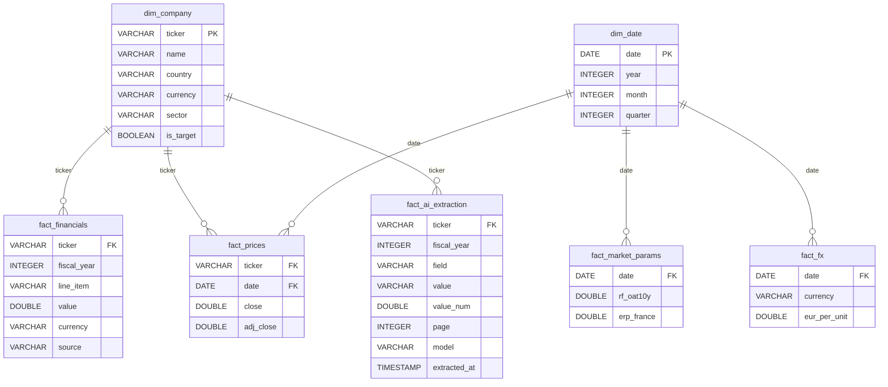
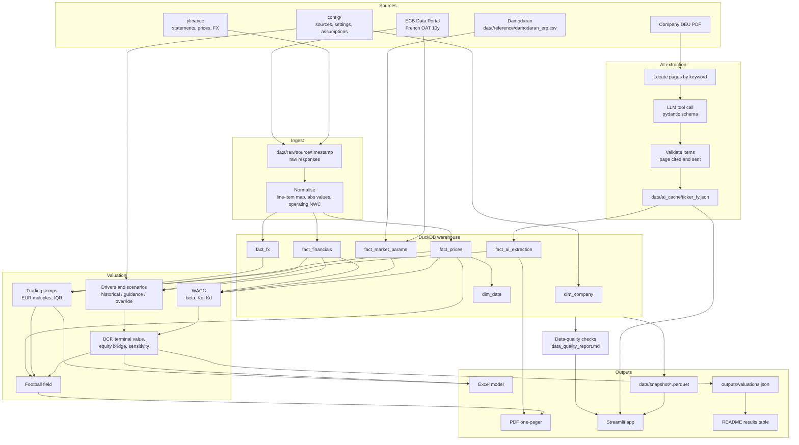

# Data model and lineage

## Star schema

Two dimensions (company, date) and five fact tables. DuckDB does not enforce the foreign keys;
they are logical relationships used in joins and checked by the data-quality layer (non-null
keys). Column details are in [data_dictionary.md](data_dictionary.md).

Notes:

- `fact_financials` is in long format (one row per line item) so that new line items need no
  schema change. The valuation code pivots it to one column per line item.
- `fact_prices` also holds the benchmark `^STOXX50E`, which has no row in `dim_company`.
- `fact_market_params` and `fact_fx` dates are monthly ECB dates or the valuation date, which
  are not always trading dates in `dim_date`.

## Pipeline lineage

`python -m cac40val.pipeline` (or `make pipeline`) runs the steps below in order.
`--offline` skips ingestion and reuses the existing warehouse, `--refresh` re-runs the AI
extraction (needs `ANTHROPIC_API_KEY`), `--only-ai` stops after extraction and `--tickers`
restricts the valuation targets.

## Lineage guarantees

| Question | Where the answer is |
|---|---|
| Which API response did this number come from? | Timestamped file in `data/raw/<source>/` |
| Which provider supplied a financial figure? | `fact_financials.source` |
| Which page of the DEU supports an AI fact, and which model produced it? | `fact_ai_extraction.page`, `.model`, `.extracted_at` |
| Is a forecast driver historical, from guidance or an analyst override? | `driver_sources` in `outputs/valuations.json`, the app caption and the Excel Assumptions tab |
| When was the ERP taken from Damodaran? | `source_date` in `data/reference/damodaran_erp.csv` |
| What data did a published result use? | `data/snapshot/*.parquet`, committed with the outputs |
